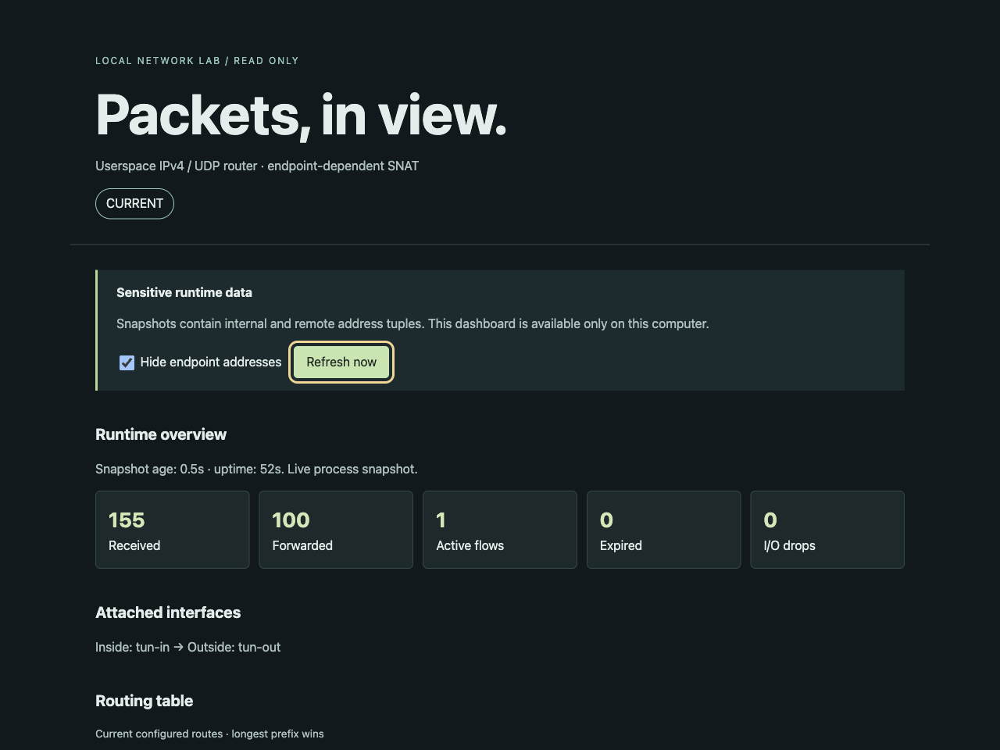
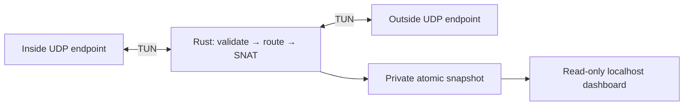

<p align="center">
  
</p>
<p align="center">
  <strong>Real packets. Bounded state. Visible decisions.</strong><br>
  A dependency-free Rust forwarding core with Linux TUN I/O and a read-only local dashboard.
</p>
<p align="center">
  <a href="#quickstart">Quickstart</a> · <a href="docs/ARCHITECTURE.md">Architecture</a> · <a href="docs/DEMO-VIDEO.md">Sampled video</a> · <a href="docs/RELEASE-STATUS.md">Verification</a> · <a href="docs/PUBLICATION-AUDIT.md">Publication audit</a>
</p>
<p align="center">
  
  
  
</p>

Forward IPv4/UDP between precreated TUN interfaces, apply longest-prefix routes,
and translate outbound flows with endpoint-dependent SNAT. Replies must match the
remote tuple. The Rust process performs forwarding and NAT; the kernel supplies
UDP endpoints and TUN boundaries.

[](docs/DEMO-VIDEO.md)

*Actual browser capture from the isolated Linux lab, November 7, 2026.*
[Watch the sampled recording](docs/qa/rendered/live-demo.mov): 12 genuine captures
spanning 20.536 seconds, replayed at 1 FPS for 12 seconds. This is a downloadable,
speed-adjusted recording, not a hosted live demo.

## What it does

- Validates IPv4 and UDP, decrements TTL, rewrites checksums and rejects unsupported packets.
- Bounds routes, active mappings and port allocation; expires idle flows and filters late replies.
- Reports actual routes, TUN identities, NAT state and counters through private atomic snapshots.
- Shows current, stale and offline telemetry on a loopback-only dashboard. Endpoint tuples are hidden by default in the UI; local API snapshots still contain them.



[Detailed architecture and safety boundaries](docs/ARCHITECTURE.md) · [Topology diagram](docs/architecture.svg)

## Quickstart

### Portable checks

With Rust/Cargo and Python 3 already installed, from the repository root:

```sh
cargo test --locked --offline
python3 -m unittest discover -s scripts -p 'test_*.py'
```

The existing baseline has **17 Rust and 27 Python tests**. Additional documentation
checks cover links, SVG safety and packaging preservation. Portable tests do not
exercise Linux TUN I/O. No Cargo or Python package dependencies are required.

### Real Linux packets

Use an explicitly authorized, isolated Linux environment with `/dev/net/tun`,
network namespace support, iproute2, Python 3, Rust and passwordless `sudo` already
available. The harness creates temporary namespaces and TUN interfaces and needs
root there. Do not run namespace setup on a shared host.

The supplied guest wrapper expects `cargo-1.89`, `rustc-1.89` and `rustdoc-1.89`:

```sh
bash scripts/guest-demo.sh
# Optional: keep genuine traffic running until Ctrl-C cleans up.
bash scripts/guest-demo.sh --retain
```

Both extended real-packet suites have passed in the isolated Ubuntu ARM64 lab,
including independent flow/port exhaustion, expiry, route overlap, reply filtering
and a stopped-router negative control. See [recorded results](docs/RELEASE-STATUS.md).

### Configured Lima demo host

`python3 scripts/demo.py` requires an existing, authorized `router-lab` Lima VM,
the guest prerequisites above, and `limactl` at the versioned user-relative path
configured in `scripts/demo.py` and `scripts/dashboard.py`. It does not install or
configure Lima and is not a general macOS dataplane setup command.

On that configured host, the command copies allowlisted source, starts real guest
traffic and serves the dashboard at <http://127.0.0.1:8765>. Ctrl-C or SIGTERM
cleans up its processes/staging and stops the VM.

## Scope and publication

This is an experimental IPv4/UDP router. TCP, IPv6, fragmentation, L2 and ICMP
generation are unsupported. There is no throughput or production-readiness claim;
the stdlib dashboard is a local lab tool.

[Public repository](https://github.com/tczartoryski/userspace-router), published after a reachable-history and media audit.
No license has been selected and no license grant is made. No release or deployment
is published by this documentation change. See [publication audit](docs/PUBLICATION-AUDIT.md).

The [banner provenance](docs/img/PROVENANCE.md) records the original artwork and
reference design intent. Browser evidence and its limitations are documented in
[rendered QA](docs/qa/RENDERED-QA.md).
