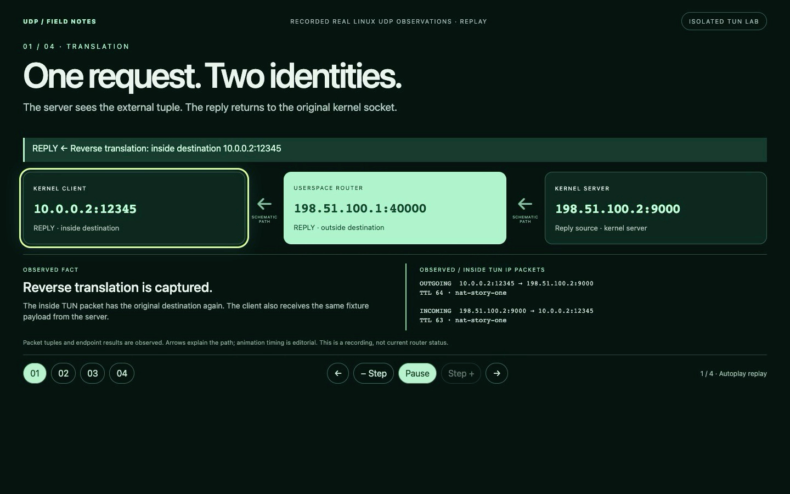
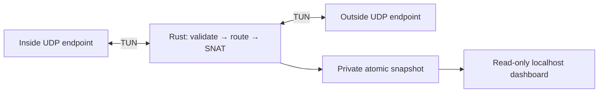
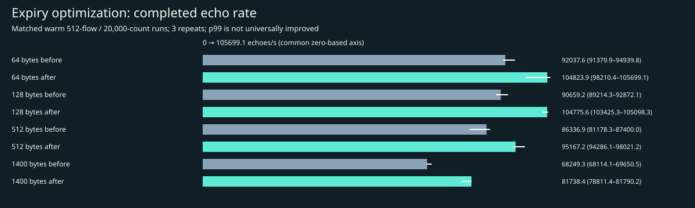
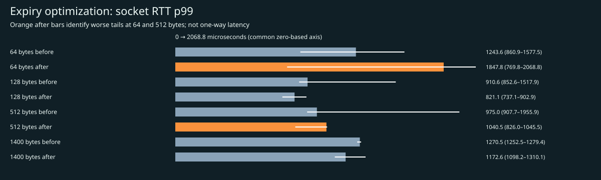
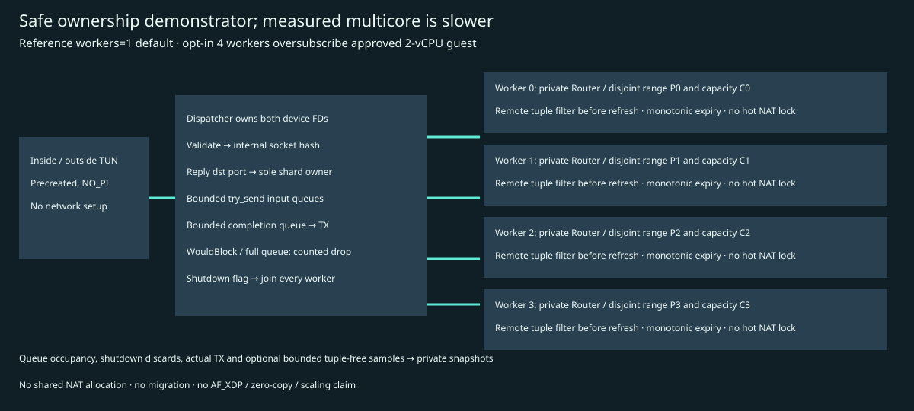
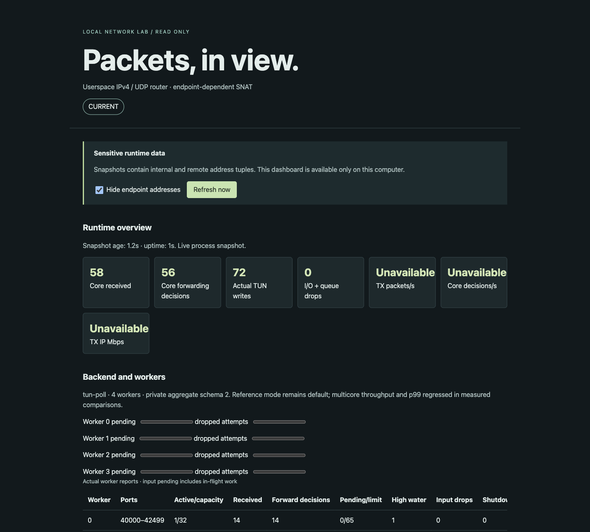

<p align="center">
  
</p>
<p align="center">
  <strong>Real packets. Bounded state. Visible decisions.</strong><br>
  A dependency-free Rust forwarding core with Linux TUN I/O and a read-only local dashboard.
</p>
<p align="center">
  <a href="#quickstart">Quickstart</a> · <a href="docs/ARCHITECTURE.md">Architecture</a> · <a href="docs/NAT-STORY.md">NAT demo</a> · <a href="docs/RELEASE-STATUS.md">Verification</a> · <a href="docs/PUBLICATION-AUDIT.md">Publication audit</a>
</p>
<p align="center">
  
  
  
</p>

Forward IPv4/UDP between precreated TUN interfaces, apply longest-prefix routes,
and translate outbound flows with endpoint-dependent SNAT. Replies must match the
remote tuple. The Rust process performs forwarding and NAT; the kernel supplies
UDP endpoints and TUN boundaries.

## Watch the NAT story

[](https://raw.githubusercontent.com/tczartoryski/userspace-router/cc95f60414a7aab467db7678ab3f7b32bfd84014/docs/qa/nat-story/nat-story.mp4)

**[Download the explanatory MP4 →](https://raw.githubusercontent.com/tczartoryski/userspace-router/cc95f60414a7aab467db7678ab3f7b32bfd84014/docs/qa/nat-story/nat-story.mp4)** · [Evidence and reproduction](docs/NAT-STORY.md)

Follow a real request and reply through translation; watch two clients share one
external address, allowed traffic pass while policy rejects a packet, and the
path fail when the router stops—then recover after restart.

Continuous browser recording of a **52-second captioned evidence replay**,
not live packet-time footage. Tuples, TTLs, delivery results and drop counters come
from actual isolated Linux UDP/TUN observations; arrows and highlight timing are
explanatory. No synthesized packets or metrics. The earlier [sampled counter
recording](docs/DEMO-VIDEO.md) remains available as historical dashboard QA.

## What it does

- Validates IPv4 and UDP, decrements TTL, rewrites checksums and rejects unsupported packets.
- Bounds routes, active mappings and port allocation; expires idle flows and filters late replies.
- Reports actual routes, TUN identities, NAT state and counters through private atomic snapshots.
- Shows current, stale and offline telemetry on a loopback-only dashboard. Endpoint tuples are hidden by default in the UI; local API snapshots still contain them.



[Detailed architecture and safety boundaries](docs/ARCHITECTURE.md) · [Topology diagram](docs/architecture.svg)

## Measured v2 work — feature branch

Default reference remains single-worker TUN. Opt-in bounded worker ownership
is implemented and Linux-tested, but is **15.68–24.69% slower** and worsens
median p99 in the tested 2-vCPU workloads. Four workers are oversubscribed.
[Measured multicore results](docs/MULTICORE-RESULTS.md). AF_XDP remains
unimplemented. Private worker/queue/TX snapshots and redacted sampling are
Linux-validated; [monitoring/resilience results](docs/MONITORING-RESULTS.md)
retain overhead, tail regressions and remaining review/demo limitations.

Software profiling identified redundant full-table expiry scans. Skipping sweeps
within the same monotonic integer second improved completed UDP echo throughput
by **10.23–19.76%** across four longer 512-flow packet-size cases in the isolated
2-vCPU Linux lab. All 252 retained experiments had zero payload losses.

This is not a universal latency win: 64-byte p99 socket RTT regressed from
1.244 ms to 1.848 ms. TUN versus kernel-veth comparison has different device and
NAT paths; lab observations are not NIC line-rate or production-capacity claims.

[Results and raw evidence](docs/benchmarks/optimization-comparison.md) ·
[Methodology](docs/BENCHMARK-METHODOLOGY.md) ·
[Optimization proof](docs/OPTIMIZATION-RESULTS.md) ·
[Remaining roadmap](docs/AGENT_PROGRESS.md)

## Quickstart

### Portable checks

With Rust/Cargo and Python 3 already installed, from the repository root:

```sh
cargo test --locked --offline
python3 -m unittest discover -s scripts -p 'test_*.py'
```

The current checks have **31 Rust and 66 Python tests**, plus a controlled-clock
JavaScript replay test. Documentation checks cover links, SVG safety and packaging preservation. Portable tests do not
exercise Linux TUN I/O. No Cargo or Python package dependencies are required.

### Real Linux packets

Use an explicitly authorized, isolated Linux environment with `/dev/net/tun`,
network namespace support, iproute2, Python 3, Rust and passwordless `sudo` already
available. The harness creates temporary namespaces and TUN interfaces and needs
root there. Do not run namespace setup on a shared host.

The supplied guest wrapper expects `cargo-1.89`, `rustc-1.89` and `rustdoc-1.89`:

```sh
bash scripts/guest-demo.sh
# Optional: keep genuine traffic running until Ctrl-C cleans up.
bash scripts/guest-demo.sh --retain
```

Both extended real-packet suites have passed in the isolated Ubuntu ARM64 lab,
including independent flow/port exhaustion, expiry, route overlap, reply filtering
and a stopped-router negative control. See [recorded results](docs/RELEASE-STATUS.md).

### Configured Lima demo host

`python3 scripts/demo.py` requires an existing, authorized `router-lab` Lima VM,
the guest prerequisites above, and `limactl` at the versioned user-relative path
configured in `scripts/demo.py` and `scripts/dashboard.py`. It does not install or
configure Lima and is not a general macOS dataplane setup command.

On that configured host, the command copies allowlisted source, starts real guest
traffic and serves the dashboard at <http://127.0.0.1:8765>. Ctrl-C or SIGTERM
cleans up its processes/staging and stops the VM.

## Router v2: measured engineering outcome

Reference **one-worker mode remains the default**. The expiry change improved
matched completed-echo throughput by 10.23–19.76%, with worse p99 RTT at 64 and
512 bytes. Opt-in multicore is an ownership and observability demonstrator:
measured throughput fell 15.68–24.69% and median p99 worsened. Four workers
oversubscribe the two-vCPU lab. No scalable-performance or production claim.

[Engineering report and full raw-data inventory](docs/V2-ENGINEERING-REPORT.md) ·
[Focused final review](docs/FINAL-REVIEW.md) · [Progress and remaining gates](docs/AGENT_PROGRESS.md)





The v2 dashboard exposes actual worker/queue/TX state through private versioned
snapshots and optional bounded tuple-free decisions. This [actual retained
stopped-state desktop capture](docs/qa/v2-monitoring/desktop.png) is **not live
traffic footage**; [mobile capture](docs/qa/v2-monitoring/mobile.png) and
[measured monitoring overhead](docs/MONITORING-RESULTS.md) retain their scope.
[Verified live capture and reproduction](docs/LIVE-V2-DEMO.md) retain genuine
current → stale → recovered → stopped states from actual UDP forwarding.

[](docs/qa/v2-live/live-v2.mp4)

[Download sampled live video](https://raw.githubusercontent.com/tczartoryski/userspace-router/feat/router-v2/docs/qa/v2-live/live-v2.mp4)
(inline playback is not guaranteed; feature-branch URL changes with the branch).
44 genuine stills targeted at 1 Hz, encoded at 1 fps for 44 seconds, no audio;
not continuous full-frame-rate footage. Chapters: current 3.579 s, stale 19.568 s,
recovery 21.565 s, stopped/offline 33.588 s. All source frames and timestamps are
retained. One resume request remained outstanding at shutdown; this is not a
zero-loss whole-movie claim. See the linked evidence for exact phase counts.

## Scope and publication

This is an experimental IPv4/UDP router. TCP, IPv6, fragmentation, L2 and ICMP
generation are unsupported. Measured lab results are available below; there is no NIC-capacity or production-readiness claim;
the stdlib dashboard is a local lab tool.

[Public repository](https://github.com/tczartoryski/userspace-router), published after a reachable-history and media audit.
No license has been selected and no license grant is made. No release or deployment
is published by this change. See [publication audit](docs/PUBLICATION-AUDIT.md).

The [banner provenance](docs/img/PROVENANCE.md) records the original artwork and
reference design intent. Browser evidence and its limitations are documented in
[rendered QA](docs/qa/RENDERED-QA.md).
