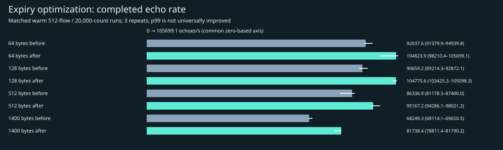
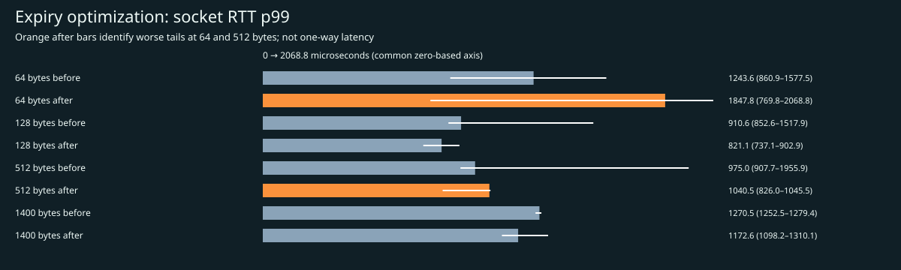
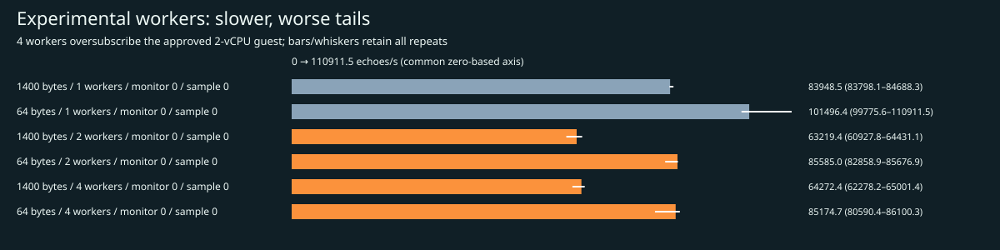
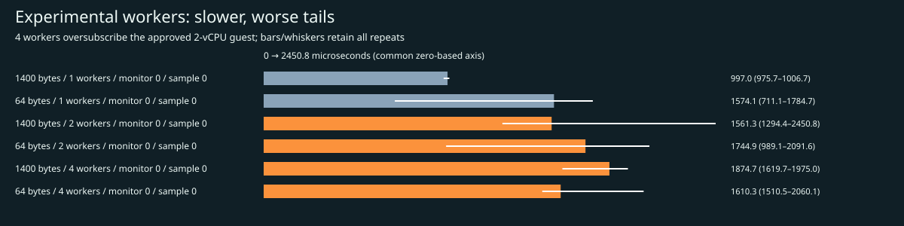
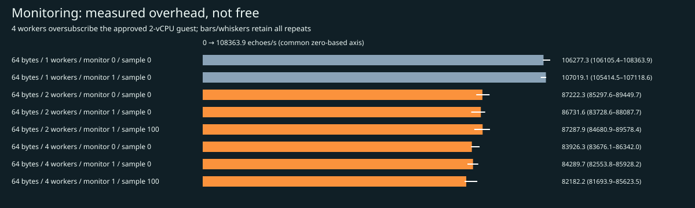
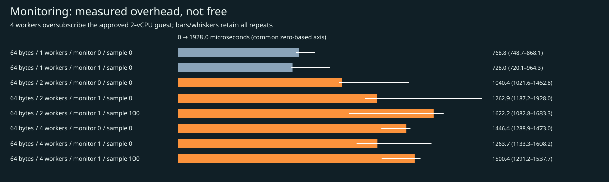

# Router v2 engineering report

Generated from every explicitly reviewed raw benchmark JSON. Source baseline for
this review: `59ff117a408f68500d26f562365c9d2430b16123`. Later review/presentation changes are in the feature PR; no main merge is authorized.
[Complete inventory, hashes, cells, MICRO cases and every diagnostic repeat](V2-ALL-DATA.md)
retain all observations. No benchmark was run by this generator.

## Engineering outcome

The expiry change is a measured throughput/CPU improvement with worse 64-byte and
512-byte p99 tails. Multicore is an experimental ownership/observability objective,
**not an optimization win**: measured throughput fell 15.68–24.69% and median p99
worsened. Keep reference workers=1 default. Safe private NAT ownership, bounded
queues, reverse port affinity and actual per-worker observability justify the
demonstrator's complexity; they do not establish scalable performance.

Implemented: validated IPv4/UDP routing and endpoint-dependent SNAT; same-second
expiry skip; pluggable owned TUN I/O; isolated worker shards; bounded queues,
backpressure and shutdown; private schema-1/2 snapshots; optional tuple-free
samples; strict loopback readers/dashboard; reproducible real packet harnesses.
Incomplete: general protocol/router support, production fault qualification,
steady fsync overhead isolation, separate worker CPU and AF_XDP. The corrected live gate passed; see evidence below.

## Matched original/final expiry comparison

All four sizes, 512 flows, 20,000 echoes/window64, three repeats before/after.
Rates count completed echoes. Completed packet traversals/s = 2 × echoes/s;
neither metric is hardware NIC line rate. RTT columns are median repeat quantiles.
No fastest-run selection. Full ranges, CPU/RSS and all smaller cells are linked.

| Total IPv4 bytes | Before echoes/s (range) | After echoes/s (range) | Change | Completed traversals/s | RTT p50 / p95 / p99 µs before → after | CPU seconds (range) | Sampled RSS bytes (range) |
|---:|---|---|---:|---|---|---|---|
| 64 | 92037.6 (91379.9–94939.8) | 104823.9 (98210.4–105699.1) | +13.89% | 184075 → 209648 | 569.0 → 468.8 / 758.9 → 668.8 / 1243.6 → 1847.8 | 0.080 (0.080–0.090) → 0.060 (0.050–0.060) | 1835008 (1835008–1835008) → 1835008 (1835008–1835008) |
| 128 | 90659.2 (89214.3–92872.1) | 104775.6 (103425.3–105098.3) | +15.57% | 181318 → 209551 | 586.3 → 477.1 / 770.1 → 682.7 / 910.6 → 821.1 | 0.090 (0.090–0.090) → 0.060 (0.060–0.060) | 1835008 (1835008–1835008) → 1835008 (1835008–1835008) |
| 512 | 86336.9 (81178.3–87400.0) | 95167.2 (94286.1–98021.2) | +10.23% | 172674 → 190334 | 652.4 → 538.0 / 851.0 → 714.1 / 975.0 → 1040.5 | 0.090 (0.080–0.100) → 0.070 (0.060–0.080) | 1835008 (1835008–1835008) → 1835008 (1835008–1835008) |
| 1400 | 68249.3 (68114.1–69650.5) | 81738.4 (78811.4–81790.2) | +19.76% | 136499 → 163477 | 890.7 → 694.0 / 1174.8 → 913.9 / 1270.5 → 1172.6 | 0.130 (0.120–0.130) → 0.090 (0.090–0.100) | 1835008 (1835008–1835008) → 1835008 (1835008–1835008) |

The frozen baseline core is identified in [optimization provenance](OPTIMIZATION-RESULTS.md).
Feature stages: `5ec52e7` audit/MICRO, `01300cc` E2E/profiles,
`0d4e818` measured expiry change, `f6679fb` worker ownership,
`59ff117` private observability/resilience. Full history remains sanitized.

## Contextual kernel comparison and all cells

[All retained uninstrumented cells](V2-ALL-DATA.md) cover sizes 64/128/512/1400,
flows 1/64/512, cold/warm, three repeats, userspace and kernel baseline. Later
userspace after runs reuse the unchanged original kernel comparison; these are
not independent new kernel measurements. Raw source artifacts remain linked,
including shorter count 1500 cells and longer count 20000 cells: do not conflate them.
[All-cell chart](v2-all-e2e.svg) displays every uninstrumented group separately.
TUN/poll/read/write/custom NAT and veth/kernel conntrack have different devices,
L2/neighbor, scheduling and NAT semantics. This is contextual system comparison,
not isolated algorithm attribution. [Exact methodology](BENCHMARK-METHODOLOGY.md).

## Worker scaling, CPU and profiles

[Every worker cell, tails, CPU and RSS](V2-ALL-DATA.md) includes both sizes and all
three repeats; [measured interpretation](MULTICORE-RESULTS.md). Four workers
oversubscribe two guest CPUs plus dispatcher/endpoints. Aggregate profiles show
channels/futex, wakeup/syscall and datagram receive costs replacing part of tuple
scan share. This is sampled attribution, not a proven isolated cost breakdown.
Baseline 999-Hz expiry retain shares were 40.00/46.25/41.98%, about 80 samples/run;
separate expiry diagnostic task-clock median went 82.06 ms to 55.98 ms. Hardware
cycles/instructions are unsupported. Process CPU has 10-ms tick resolution;
RSS is sampled, not lifetime peak. Per-worker CPU is unmeasured. Instrumented PPS
is excluded from headline throughput and remains only in raw diagnostic files.

## Monitoring and privacy

All monitoring cells/counts/window/sample settings, min/max, tails, CPU and RSS
are retained in [the appendix](V2-ALL-DATA.md), with [interpretation](MONITORING-RESULTS.md).
Short cells do not isolate steady fsync/export cost. The paced >=3 s correctness
acceptance proves actual periodic writes, not free or steady-state monitoring.
Schema2 omits tuples/payloads; sampling defaults off, capped at 64 per worker. Schema1
retains explicitly sensitive reference tuples. 0700/0600 atomic bounded snapshots,
strict field validation and fixed-command loopback viewer guards remain in force.

## Correctness, resilience and security

Native Linux 30 Rust tests and 58 Python tests were verified at `59ff117`, along with
actual four-worker adversarial/overload/steady snapshot acceptance; new portable
review checks are recorded in [final review](FINAL-REVIEW.md). Exact checksum,
fragment/length, expiry/backward-clock, tuple filtering, disjoint port/capacity,
queue saturation and shutdown tests remain. Generated/fuzz inputs are portable
correctness tools, not live evidence. [Actual gates](RESILIENCE.md) distinguish
passed tests from the unrun broader OS fault campaign. Dashboard screenshots in
[monitoring results](MONITORING-RESULTS.md) show actual retained stopped data;
current/stale/offline live browser transitions passed in the retained successful run.

## Verified live browser evidence

The corrected fixed-private-directory guest gate passed. [Capture metadata](qa/v2-live/capture.json),
[actual socket observations](qa/v2-live/observations.json), all 44 source PNGs and
[H.264 video](qa/v2-live/live-v2.mp4) retain the successful run. Genuine browser
stills targeted 1 Hz; the 44-second, 1440×1300 video encodes those 44 frames at
1 fps with no audio. This is sampled footage, not continuous full-frame-rate video.
Coordinator AVFoundation validation decoded all 44 frames and checked dimensions,
duration, audio absence and extracted current/stale/offline frames. No DOM or
snapshot timestamps were rewritten; source hashes and actual capture times remain.

| Browser chapter | Frame | Actual capture elapsed |
|---|---:|---:|
| First current snapshot | 3 | 3.579 s |
| Stale after owned-router SIGSTOP | 19 | 19.568 s |
| Current recovery after SIGCONT | 21 | 21.565 s |
| Stopped/offline after SIGTERM | 33 | 33.588 s |

Initial unavailable frames precede the first snapshot; final unavailable frames
follow cleanup. All frames are retained, including those transitions. Verified
replies by **send phase** were current 444/444, stale 116/116, resume 443/444 and
offline 0/148. Stale-phase sends were delivered after resume, not during SIGSTOP;
one resume request was outstanding at shutdown. The server echoed 1003 packets.
This is not a zero-loss whole-movie claim or throughput benchmark. Periodic worker
observations can lag dispatcher TX, so live TX may exceed sampled core decisions;
final joined counters conserve all 2006 forwarding decisions and writes.

The initial failed private-home traversal attempt is excluded from public capture
artifacts. The fix exclusively creates root-owned `/tmp/udp-router-v2-live` 0700
with snapshot 0600, without chmod or security weakening. The coordinator stopped
and cleaned the guest, namespaces and helpers; intentionally SIGTERMed the viewer
(exit 15) and closed the tab. No live process is distributed with this evidence.

## Cost, efficiency and limits

One native Sol lane; no extra agents, installs, provider/resource changes or new
paid services in this phase. Last supplied subscription usage was 5% weekly;
that is historical, not a current quota reading. Exact dollar/token totals and
aggregate tool/call counts are unavailable and are not estimated.

IPv4/UDP only; no TCP/IPv6/fragments/L2/ICMP generation or production-readiness
claim. Wider OS fault injection, monitored panic/FD failures, SIGKILL recovery,
long randomized steady export timing and separate worker CPU remain gaps.
AF_XDP is unimplemented: AF_XDP-specific attach authority/test topology,
Ethernet/L2 semantics, UMEM/ring lifetime/ownership and real acceptance/measurement
are missing. No batching, migration, multiqueue or zero-copy performance claim.

## Reproduction and handoff

`python3 -B scripts/report_v2.py` regenerates this report, full inventory and SVGs
without packet generation/network/VM operations. Existing guest reproduction:
[benchmarks](BENCHMARK-METHODOLOGY.md), [ownership](MULTICORE-DESIGN.md),
[observability](OBSERVABILITY.md), [resilience](RESILIENCE.md).
[Architecture ownership diagram](v2-architecture.svg) distinguishes dispatcher
TUN ownership from per-worker NAT ownership.

| Category | Handoff status |
|---|---|
| Audit, portable tests and sanitized baseline | VERIFIED at recorded stages |
| Real core optimization and full retained comparisons | VERIFIED gains and tail regressions |
| Worker ownership/correctness | VERIFIED tested cases; performance regressed |
| Actual-state snapshots/privacy and adversarial overload | VERIFIED measured acceptance; wider faults CONDITIONAL/UNRUN |
| Steady monitoring cost / per-worker CPU / hardware | CONDITIONAL/UNRUN, not established |
| Live browser current→stale→offline / genuine new demo | VERIFIED retained successful sampled browser capture |
| AF_XDP / production readiness | CONDITIONAL/UNRUN; unimplemented / not claimed |
| Project code review / portable gates | VERIFIED focused review; 31 Rust / 66 Python tests |
| Costs and accounting | VERIFIED historical 5% disclosure; dollars/tokens/call totals unavailable |
| Final sanitized feature PR | Delivery for owner review; no main merge/release/license change |
